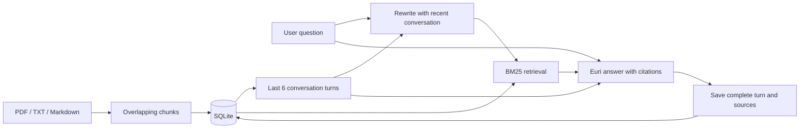

# Recall — Conversational RAG Agent

A Python application that answers questions over PDF, TXT, and Markdown files using Euri and remembers the conversation. Follow-up questions such as **“What are its benefits?”** are rewritten with the previous topic before retrieval.

## Run locally

Python 3.10+ is required. In PowerShell, from this folder:

```powershell
python -m venv .venv
.\.venv\Scripts\python.exe -m pip install -r requirements.txt
Copy-Item .env.example .env
# Edit .env and replace the placeholder with your own Euri API key.
.\.venv\Scripts\python.exe -m streamlit run app.py
```

Open the local URL printed by Streamlit, normally http://localhost:8501. You can also enter your key in the password field in the sidebar. Do not put the key in source code, screenshots, or your video. `.env` is excluded from Git.

The app uses the endpoint and default model supplied in the assignment snippet:

```text
EURI_BASE_URL=https://api.euron.one/api/v1/euri
EURI_MODEL=gemini-3.5-flash-lite
```

The model name is configurable in the sidebar or `.env`; availability depends on your Euri account. A real API key is required for generated answers. There is no built-in live key or simulated answer mode.

## Try the conversation

1. Click **Load sample: Agentic AI** (or upload files and click **Index uploaded documents**).
2. Ask **What is Agentic AI?**
3. Ask **What are its benefits?**
4. Open **Sources & retrieval details** to inspect the resolved search query and cited passages.
5. Ask **Explain those benefits in simple terms.**
6. Ask an unsupported question such as **What is the capital of Iceland?** to demonstrate the evidence limitation.
7. Start a new conversation to demonstrate isolation, then select the saved conversation to resume it.

## How it works



- `app.py`: Streamlit chat interface, upload flow, saved sessions, source inspection, transcript export, and error messages.
- `rag.py`: parsing, 220-word chunks with 40-word overlap, BM25 search, SQLite persistence, Euri client, and history-aware RAG orchestration.
- `sample_docs/agentic_ai.md`: sample knowledge base for the demonstration.
- `tests/`: automated pipeline and UI tests with mocked model responses; no credits or API keys needed.
- `VIDEO_WALKTHROUGH.md`: suggested recording sequence and explanation tied to the code.

Memory is stored in `data/rag.db`, with separate documents and messages per conversation. All messages persist, but only the latest 12 messages (6 complete turns, each capped at 4,000 characters) are passed to the model. Clearing memory removes that conversation's messages while retaining its documents. Document content hashes prevent duplicate indexing. Successful question/answer pairs are saved in one transaction; failed calls do not leave half a turn.

On the first question, the app retrieves directly and makes one answer request. On follow-ups, it first makes a query-rewriting request, then retrieves and generates. If retrieval returns no matches, it responds with an evidence limitation without making the answer-generation request. Source passages are displayed so users can check generated citations.

## Validation

```powershell
.\.venv\Scripts\python.exe -m unittest discover -s tests -v
```

Tests cover follow-up context, source persistence, session isolation, no-match retrieval, API failures, memory reset, duplicate documents, chunk overlap, ranking, invalid input, missing keys, and the UI chat flow. Live provider access needs a separately configured real key; mocked tests do not verify model availability or real response quality.

## Scope and limitations

This is a local, single-user assignment app, not an authenticated multi-user service. Saved data is local plaintext SQLite. Retrieved passages and recent history are sent to Euri for live generation. It uses lexical BM25 retrieval rather than dense embeddings, so synonym-only matches can be missed. PDFs must contain extractable text; OCR is not included. The complete transcript persists but older turns outside the model window are not recalled automatically. Grounding and citations are prompted, not a guarantee of factual correctness; inspect the displayed evidence.

The supplied assignment text was incomplete and no previous RAG implementation was present. This project implements conversational document retrieval and memory from scratch. If your full rubric explicitly requires vector embeddings, a specific framework, or additional agent tools, those would be further requirements.

Implementation references: [OpenAI Python SDK](https://github.com/openai/openai-python), [Streamlit chat input](https://docs.streamlit.io/develop/api-reference/chat/st.chat_input), and [Streamlit AppTest](https://docs.streamlit.io/develop/api-reference/app-testing/st.testing.v1.apptest).
